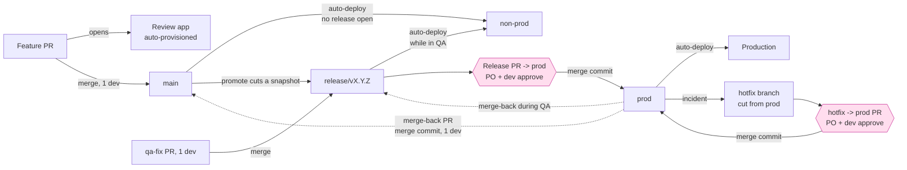

# Deployment & environments

How code reaches users. **The repo declares its own model** in
`policy/delivery.yml` - environments, what merging deploys, how production is
approved (`production_gate`), whether review apps exist, and what it reports to a
human - and the always-on rule `45-delivery.md` -> Deployment & environments follows that file rather than
imposing one. `/steer:setup protect` reads `production_gate` to decide whether a `prod`
branch is expected at all, and enforces the branch side at the server edge via
`policy/branch-protection.yml`.

What the rest of this page describes is the **org default** that file is seeded
with - branch-driven promotion on AWS - and why it has that shape. A repo that
delivers elsewhere, or nowhere, edits the file; only a gate *weaker* than this
default needs an ADR. Merge and deploy stay human decisions in every model.

Deploy/release logic is a [high-risk area](../reference/configuration.md): validate
in non-prod before prod, and scope pipeline changes with the dev first. The
AWS/Terragrunt specifics live in each product's `/infra/README.md`.

## Environments

- **`non-prod`** - a shared environment for integration and validation. It
  runs `main`, except while a Release PR is open: then it runs that release
  branch, so QA tests exactly what will ship.
- **`prod`** - production.
- **Review apps** - every feature PR also gets an isolated, auto-provisioned
  environment, torn down when the PR merges or closes. The review-app mechanism is
  product-specific, so it is recorded in an ADR rather than hard-coded by the
  plugin.

## Promotion

Promotion is driven by branches, never by pushing to an environment directly:

- **Merge to `main` auto-deploys `non-prod`.** Landing on the default branch is
  the trigger; there is no separate "deploy to staging" step - unless a release
  is in QA (below).
- **Prod is gated by a Release PR from a `release/vX.Y.Z` snapshot into a
  long-lived `prod` branch.** [`/steer:work promote`](../workflows/work.md) cuts
  the snapshot at the changelog cut's merge commit on `main`, opens the Release
  PR and stops; merging it auto-deploys production. Prod receives exactly what QA
  tested while `main` keeps taking merges. **Never push directly to `prod`.**
- **While the Release PR is open, non-prod runs the release branch**, and the
  PO tests it there for as long as QA needs. Merges into `main` continue but deploy only once the Release PR closes. The
  environment held is `policy/delivery.yml`'s `release_hold` (default
  `non-prod`; `none` turns it off). Steer ships no deploy workflow - deploys are
  product-specific - so each product's deploy job asks
  `scripts/release-target.sh` which branch to deploy (the contract is in the
  scaffold's `infra/README.md`).
- **QA fixes land on the release branch.** A `qa-fix/<n>` PR into
  `release/vX.Y.Z`: one dev approval, `ci` green, no changelog fragment (the
  release's entries already describe the work it repairs). Merging it redeploys
  non-prod and dismisses the Release PR's approvals, so QA re-tests and the
  approvers look again.
- **The `prod` promotion is also the release moment.** An app or service deploys
  continuously, so its changelog is cut at promotion, from the fragments
  accumulated since the last one - `changie batch auto` then `changie merge`,
  a semver `vX.Y.Z` whose bump the fragments' kinds decide (every profile
  versions this way). The cut lands first, as its own PR to
  the default branch (`.changes/unreleased/` lives there, and you cannot push to a
  protected `main`); `promote` cuts the release branch once that has merged. See
  [Repository contract](../reference/repository-contract.md#what-a-managed-repo-carries).
- **Every release is tagged and published automatically.** When a new version
  reaches `prod` - a promotion or a hotfix - the scaffold's `release.yml`
  workflow tags that commit `vX.Y.Z` and publishes a GitHub Release with the
  version's changelog entries and the list of merged PRs. A repo that deploys
  from `main` (any other `production_gate`) publishes from `main` instead.
  GitHub then deletes the merged release branch: `/steer:setup protect` turns on
  `delete_branch_on_merge`, so a `release/*` branch exists only while its
  release is in QA.
- **Prod is merged back into `main`.** After a `release/*` or `hotfix/*` PR
  merges into `prod`, the scaffold's `merge-back.yml` pushes
  `merge-back/<pr>-to-main` at prod's tip and comments a link on the merged PR;
  a dev opens that PR and merges it with **Create a merge commit**, never
  squash. A conflict is resolved on the merge-back branch, never on `prod`.
  Features still squash, so these merge commits are the only ones `main`
  takes (linear history is off there). It does not open the PR itself with
  `GITHUB_TOKEN`: that needs "Allow GitHub Actions to create and approve pull
  requests", which also lets any workflow approve a PR. A GitHub App token is the
  opt-in for opening it automatically.
- **Nothing `prod` ships is dropped.** The required `ci` check runs
  `ci:promotion`: a PR into `prod` must come from `release/*` or `hotfix/*`, and
  a release must contain `prod`. It fails while a merge-back is unmerged, or
  was squashed.
- **Who approves what.** A PR into `main`, a QA fix and a merge-back PR: one dev.
  A Release PR or a hotfix PR into `prod`: a member of the PO team **and** a
  member of the dev team - 2 approvals, never the author nor whoever pushed last,
  no bypass. GitHub enforces the two-team rule only through a repository ruleset
  ("required reviewers"), which `/steer:setup protect` applies beside classic
  branch protection; both teams need Write access. That approval *is* the
  production gate: it stands in for the deployment-environment approvals that
  GitHub Enterprise would otherwise provide. See
  [GitHub integration](../reference/github-integration.md#production-promotion-gate)
  for how that protection is configured.

### Who acts at each step

| Step | Who acts | What happens |
|---|---|---|
| 1. Feature PR | Dev | A second dev approves; the merge deploys non-prod. |
| 2. Cut the release branch | Dev or PO | `/steer:work promote` cuts the changelog, then a temporary `release/vX.Y.Z` from `main`, and opens the Release PR into `prod`. |
| 3. QA on non-prod | PO, dev | Non-prod runs the release branch; the PO tests, a dev fixes by a `qa-fix/<n>` PR into it. `main` keeps merging. |
| 4. Approve the Release PR | PO, dev | One PO team member and one dev team member approve; never the author. |
| 5. Ship and tag | Automation | The merge deploys prod, `release.yml` tags `vX.Y.Z` and publishes the Release, GitHub deletes the release branch. |
| 6. Hotfix | Dev, PO | Cut from `prod`; the same PO and dev approvals as a Release PR. |
| 7. Merge-back | Automation, dev | `merge-back.yml` pushes a branch at prod's tip and posts a link; a dev opens the PR and merges it with a merge commit. The next release fails `ci:promotion` until it lands. |

## Hotfixes

A production incident ([`/steer:work --hotfix`](../workflows/work.md)) cannot
ride the normal path: `main` holds work that has not been released, and a fix
cut from it would ship that work too. So the hotfix path runs beside `prod`:

- **Branch from `prod`, PR into `prod`.** The branch is `hotfix/<n>-slug`; a PO
  and a dev approve and CI is green, the same gate as a Release PR.
- **The PR carries its own patch release.** Its fragment is cut on the branch
  (`changie batch patch`), so merging it ships a new patch version - there is no
  separate promotion to wait for.
- **Merge back into `main`, always.** Right after the merge, `merge-back.yml`
  pushes a `merge-back/*` branch at prod's tip for `main` (and, while a release
  is in QA, one for the open release branch) for a dev to open as an ordinary
  PR - never a PR whose head is `prod`, where resolving a conflict would commit
  into production. `/steer:work promote` refuses to cut the next release, and
  `ci:promotion` fails its Release PR, while a hotfix is missing from it.

When `production_gate` is not `prod-branch-pr`, production deploys from the
default branch, so the hotfix branches from and targets it like any change.

!!! note "This is the graduated end-state, not the solo-trunk start"
    A pre-MVP [solo-trunk](authorization-model.md) repo has no PR wall yet - it
    commits straight to `main`. The promotion model above is what a repo runs once
    [`/steer:setup protect`](../reference/skills.md) has raised branch protection. Merge
    and deploy stay human-gated in **both** modes.

## Container images

Deployable apps ship as **container images** (default target: AWS ECS). Each
`apps/<app>` that deploys as a container carries its own `Dockerfile`, instantiated
from the plugin's `templates/docker/` reference when the app is first created - by
[`/steer:build`](../workflows/build.md) or [`/steer:setup adopt`](../workflows/adopt.md),
which copy-and-adapt it and never clobber an existing one. A Node/Next.js template
and a Python/uv template are provided; the base-image major must satisfy
`policy/versions.yml` (enforced by the version-pin scanner).

The template is **not** installed at bootstrap - a Dockerfile with no app to build
would ship broken - and `library`, `cli`, and `infra` repos do not deploy as
containers, so they get none. The scaffold CI **builds every `apps/*/Dockerfile`
(and a root `Dockerfile`) when present** - build-only, no registry push - so an
image that stops building fails the PR; when none exists the step is skipped with a
notice, so a green build never falsely implies an image was produced. Pushing and
deploying the image is product-specific and lives in each product's `/infra`.

## Observable by default

A deployed environment is not "done" until it is observable. The standard requires:

- structured **logs**,
- **metrics with alarms**,
- **error tracking** (Sentry),
- **health checks**, and
- **alerting** routed somewhere a human actually sees it.

"Deployed but unobservable" does not count as delivered; the wiring is captured in
the product's `ARCHITECTURE.md`. What a deployed environment reports to a human is
declared in `policy/delivery.yml`'s `observability` list (the scaffold seeds
`[sentry]`); an empty list means not wired yet, which steer flags as a gap to
close rather than a failure to fix now.

## Rollback

Every prod deploy has a **known rollback** before it ships - either a revert
shipped as a hotfix (a `hotfix/*` PR into `prod`, same approvers) or a redeploy
of the prior SHA. The merge-back bot flags a revert for a human to decide whether
`main` keeps it. Database migrations follow an
**expand/contract** pattern so the previous version keeps running through a deploy,
which is what makes a clean rollback possible.

## Secrets & config at rest

Secrets and configuration are injected at deploy/runtime - **never baked into
images or CI logs**. See rule `60-high-risk` -> Secrets handling and
[Configuration](../reference/configuration.md) for where this is enforced.

## Related

- [Authorization model](authorization-model.md) - what is autonomous vs. gated,
  including solo-trunk mode and graduation.
- [GitHub integration](../reference/github-integration.md) - branch protection,
  the `prod` promotion gate, and Dependabot auto-merge.
- [First workflow](../getting-started/first-workflow.md) - where productionization
  fits in the lifecycle.
