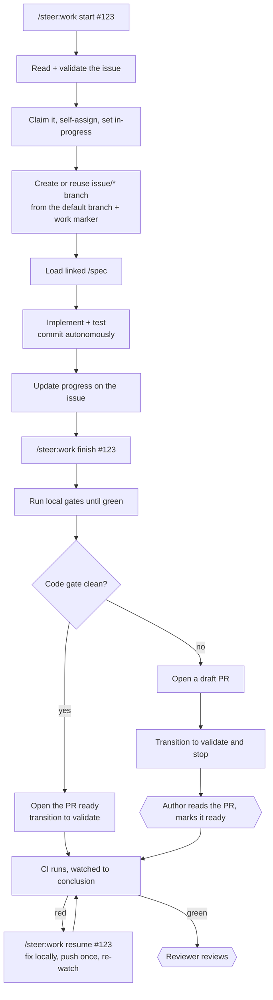

# `/steer:work`

Execute a GitHub issue end-to-end from local Claude Code. The same door carries
the backlog: [`/steer:work issues`](issues.md) manages it and never edits code,
while the subcommands below read an issue and deliver it.

!!! info "When to use"
    Use to start, resume, check, or finish a specific issue.

**Argument hint:** `[start | resume | status | finish | queue | debug | qa | promote | tidy | review | walkthrough <feature> | issues <mode>] [--reviewed | --hotfix] [#issue ...]`

!!! tip "Review gates - `finish` and `--reviewed`"
    `finish` runs an independent code gate on every non-Trivial change (a
    `--hotfix` always counts as non-Trivial): a fresh
    adversarial reviewer checks correctness, other instances of the fixed
    pattern, peer consistency, introduced risk and touched docs; a database,
    UI or security specialist joins when the diff enters that domain; a
    verifier tries to refute each high finding before it reaches the author;
    and a bounded fix loop follows: it stops on a round with no confirmed
    high finding, re-reviews only while that count drops round over round,
    and never runs more than 4 rounds.
    Add `--reviewed` for an independent plan-gate review and plan sign-off
    before implementing: the reviewer checks what the plan misses, searches
    the repo for existing code the plan would duplicate, and flags every
    design choice the plan leaves to implementation. High-risk work gets the
    plan gate without the flag (except under `--hotfix`), and its sign-off is
    the dev scoping High-risk work already requires: with no dev in the
    session, in/out scope recorded on the issue stands in for it, and with
    none recorded `start` asks for scope on the issue and stops before any
    code; a pre-production repo needs no sign-off. A reviewer that returns
    no report is retried once, then reported `not run` - never as clean.
    The shared protocol and rubric live in
    `templates/reference/REVIEW-LOOP.md`.

!!! warning "`--hotfix` - the production-incident fast-path"
    Add `--hotfix` **only** for a genuine production incident - a change to an
    already-deployed system with real users/data **and** an active outage or
    regression (rule `61-gates` -> Hotfix). "Urgent" feature work is not a hotfix, and
    "production is down" alone does not open it: the skill declines the lane
    when the `CLAUDE.md` delivery mode is `solo-trunk` or `policy/delivery.yml`
    rules production out, opens it on a `live` feature, and with neither asks
    which deployed environment is down, planning on the normal flow until the
    answer names one. The lane
    relaxes *ceremony and ordering* - the issue may be filed after-the-fact on a
    `hotfix/<n>-slug` branch cut from and merged into `prod` (carrying its own
    patch cut, then merged back into `main` - see
    [Deployment](../concepts/deployment.md#hotfixes)), and the PR goes to the front of the review queue with the same approvers as a release (a PO and a dev) - but keeps **every human
    authority gate** (merge / deploy stay human-gated; pushing the branch and
    opening the PR are autonomous, as everywhere). It still runs the local
    gates and `finish`'s code gate whatever the diff's size, but always opens
    the PR ready for review, whatever the gate left open, and watches its CI to
    conclusion itself. Once the fire is
    out, a **mandatory follow-up** backfills the issue, the spec/ADR, puts the
    incident's root cause on the [enforcement ladder](#learnings-enforcement-first),
    and writes a `/spec/history/` entry: Definition of Done is *deferred, never waived*.

## End-to-end flow

## Delivery mode

How the work reaches `main` is governed by the repo's **delivery mode**, declared
in the product `CLAUDE.md` `## Delivery mode` section (the same marker the steer
hooks read - `solo-trunk` vs `pr-flow`; absent or unreadable -> **pr-flow**).
**Issue-first holds in both modes** - [High-risk](../concepts/sdlc.md#change-classification)
work and the six value cases are tied to a GitHub issue; the modes differ only in
the branch/PR ceremony around it.

| | **pr-flow** (default) | **solo-trunk** (pre-MVP greenfield) |
| --- | --- | --- |
| Branch | `issue/<n>` branch + `spec/.work` marker | none - commit straight to `main` |
| Marker | written for Stop-hook reconciliation | skipped (stay on `main`) |
| Delivery | push + open the PR autonomously; the **merge review** is the human gate (server-enforced by branch protection) | `Closes #N` trunk commit + push under [Commit autonomy](../concepts/authorization-model.md) (rule 45) |
| Terminal evidence | merged PR | closed issue from the trunk commit |

Determine the mode once at `start` / `finish`. In solo-trunk, wherever a step below
says *branch*, *marker*, or *PR*, skip it and substitute the trunk commit -
validation, managed-block progress, CI-watch (via `gh run watch` on the trunk push),
and the Definition of Done are unchanged. Committing to `main` is authorized in this
mode; **deploy stays human-gated all the same**, and graduating the repo to the PR
flow is [`/steer:setup protect`](../reference/skills.md)'s job, never this skill's.

## Modes

| Mode | What it does |
| --- | --- |
| `start` | Validate, claim (self-assigns the invoking GitHub user), branch from the freshly fetched default branch - never the checked-out work branch; stacking on another PR only when the issue needs its unmerged code, and targeting a `batch/*` branch when the dev lands many fixes as one merge - + write the work marker (pr-flow) or stay on `main` (solo-trunk), load specs, pick up the non-blocking questions gated at `implementation` as decisions this slice makes, grep `spec/learnings/` frontmatter for prior lessons that match the issue, classify the change (rule `80-change-class`, the heavier class when arguable) - High-risk runs the plan gate even without `--reviewed` - then begin implementing, a defect through `debug` (cause before fix). |
| `resume` | Pick a claimed issue back up where it left off - including offering to re-enter the Claude Code session that last worked it. |
| `status` | Report progress on the issue(s) - read-only. |
| `finish` | Run the local gates (`mise run ci`, else `mise run check`) until green before any push - CI is the confirming run, not the iteration loop, and a push made earlier goes to a draft PR. Capture any non-obvious lesson on the [enforcement ladder](#learnings-enforcement-first), then open the PR (pr-flow) - the first push of the new `issue/<n>` branch sets the upstream (`git push -u origin <branch>`; later pushes are a plain `git push`) - and transition to `validate`. The PR opens **ready** only when the code gate came back clean - no high finding is open (a Trivial change, which skips the gate, qualifies), nothing went under *Notes for the reviewer*, no drift class is flagged, no question awaits confirmation - and `finish` then watches its CI to conclusion; a later clean `finish` readies an earlier draft. Anything else opens **as a draft** and stops: the author reads it and marks it ready, which starts CI and makes that run theirs. In solo-trunk, commit straight to `main` with a `Closes #N` trailer and **watch CI to conclusion** (`gh run watch`). A red build - on a ready PR, picked up by `resume`, or on the trunk push - is reproduced and fixed locally, then pushed once, never a push per attempt. When the branch changes a `contract.md`, the PR body's **Spec delta** lists the added, modified and removed requirement IDs, derived from the git diff (each removed one with a Reason and a Migration line). The PR also lists each question `start` picked up, for its owner to confirm on the running change. With no authenticated `gh`, the PR is opened or updated through the GitHub MCP server (always as a draft, since its CI cannot be watched), and with neither it prints the compare URL for you to open as a draft; the CI watch needs `gh`, so without it a ready PR's or trunk push's CI is reported as not watched. |
| `queue #A #B ...` | Deliver several independent issues one after another, one fresh worker each - see below. Entered automatically when an implement ask names two or more issues. |
| `review [#PR ...] [--mine]` | Clear the PR review queue in one batch - see below. Not issue-scoped. |
| `debug [#N \| <symptom>]` | Root cause before the fix - see below. With only a symptom and no fix asked, diagnosis only and not issue-scoped. |
| `qa [#N]` | Opt-in browser QA of the flows the branch diff touches - see below. |
| `promote` | Not issue-scoped - ships what is already merged. Run by a dev or the PO. Reads `policy/delivery.yml`'s `production_gate` (absent -> `prod-branch-pr`), shows what would ship, cuts the changelog in its own PR to the default branch, then, once that has merged, cuts a `release/vX.Y.Z` snapshot branch at the cut's merge commit, opens the Release PR `release/vX.Y.Z` -> `prod`, and stops: merging it deploys production and is the human's gate, approved by a PO team member and a dev team member. While it is open, non-prod runs the release branch for the PO to test, QA fixes go in as `qa-fix/<n>` PRs into it, and `main` keeps taking merges that deploy once it closes; after the merge, `merge-back.yml` pushes a merge-back branch at prod's tip for a dev to merge into `main` with a merge commit; the next Release PR fails `ci:promotion` until it lands. Any other gate value (`github-environment`, `manual`, `none`) stops there: there is no promotion PR to open. |
| `tidy` | Not issue-scoped - sweeps loose files at the repo root into `/spec/reference` and `/spec/design`: confidently classified strays move now, every rename and delete waits for a yes. Changes where files live, never behavior. |

## Issue queue - `/steer:work queue`

`queue` delivers a list of independent issues in one run, in the order given.
You don't have to name it: an implement ask naming two or more issues ("fix #12
and #15", `/steer:work #12 #15`) runs as a queue automatically, unless you ask
for them combined in one branch. The session orchestrates and implements
nothing itself:

1. **Triage from metadata** - an issue claimed by someone else, not ready,
   High-risk with no agreed scope, or dependent on another queued issue is set
   aside with its reason. Dependent work belongs in a stack or a `batch/*`
   branch, not a queue.
2. **One fresh worker per issue, in its own worktree.** It loads the rules,
   runs the normal `start` -> `finish` flow (local gates, code gate, a PR off
   the default branch - ready on a clean gate, else a draft) and returns a short card. Every non-Trivial issue
   also gets the independent plan gate by default, without stopping for your
   sign-off; `--reviewed` adds the sign-off, and a plan whose high findings will
   not resolve comes back to you instead of being built. In solo-trunk the workers
   run one at a time in the main checkout.
3. **Verify, don't trust** - the PR exists, targets the default branch (a ready
   one with a clean gate and green CI on its card), and the issue is in
   `validate`.
4. **Record and continue** - a blocked issue is recorded and the next one
   starts. Human gates (`--reviewed` plan sign-off, an unresolved plan, a `Proposed`
   ADR, a product question) are asked in the session. The queue stops early only on a
   failure that would hit every issue.

It ends with one table of issue -> PR or blocker, and points at
`/steer:work review --mine` to ready the drafts. **The orchestrator never merges
or readies a PR.** `--reviewed` carries over to every worker; `--hotfix` is refused.

## Batch review - `/steer:work review`

`review` drains a review queue in one pass. It reads every PR awaiting your review (`review-requested:@me`, or the numbers
given) and does the reviewer's legwork in parallel:

1. **Triage from metadata** in one `gh pr list` call - draft, red CI and
   conflicting PRs go straight to *Blocked* without a review. A stacked PR
   adds one lookup for a GitHub native stack: merging it merges every PR
   below it, so its readiness is judged across the whole stack.
2. **One read-only reviewer subagent per remaining PR**, all at once, each
   returning a seven-line card: what it does, change class, tests and contract
   coverage, drift flags, findings with `path:line`, design questions for the
   author, a suggested verdict. A fresh verifier then tries to refute each
   card's high findings: a refuted one leaves the card, an unsure one stays
   marked unconfirmed.
3. **Four buckets** - *Ready*, *Changes*, *Look* (High-risk or drift-flagged:
   never batch-approved) and *Blocked*.
4. **One question, one command.** You reply with the *Ready* PRs to approve
   (or `ready` for all of them); the approvals post in a single command, and a
   PR pushed to since its card was built is skipped. The command runs the same
   in sh, bash and zsh, and names each PR it could not look up or approve
   rather than reporting it as changed. Findings on the *Changes* PRs you name
   post as change requests.
5. **Then each *Look* PR, presented whole** - its full card in one message,
   one decision for the PR - never in parts.

The approval is yours: nothing is pre-selected, an ambient "ok" approves
nothing, and an unattended loop never approves. **It never merges.**

`review --mine` is the author's side - your own queued PRs, which GitHub will
not let you approve. It marks finished drafts ready, routes red or conflicting
ones to `resume`, retargets an independent stacked PR onto the default branch
(a native stack is reported to you instead - leaving one is a restructuring),
and asks you who should review an unassigned one.

## Debugging - `/steer:work debug`

Any defect - a `bug` issue, a failing test or check, a red build `finish` must
fix, a `--hotfix` incident - follows one procedure before a line of product code
changes:

1. **Reproduce** with a command that fails every time - ideally the regression
   test the Testing rule requires - and check what changed since the last
   known-good state (`git bisect` when one is known).
2. **Trace to the source** - where the bad value is first produced, not where it
   surfaced - comparing against a working sibling path.
3. **One hypothesis at a time**, each tested with the smallest change that can
   refute it and reverted when it does.
4. **State the causal chain** from trigger to symptom with `file:line` at each
   step, the fix, and where the regression test lives.
5. **Fix test-first at the source**, then run the full local gates.

Three refuted hypotheses or failed fixes stop the loop and report what was ruled
out. A cause that is a wrong responsibility, shared state or a broken assumption
goes to the dev as a design question (a `contract.md` change or an ADR), never a
workaround. Asked only "why is this failing?", it stops at the findings and
edits nothing.

## Browser QA - `/steer:work qa`

Tests cover the code; `qa` clicks through what the diff changed before the
reviewer has to. On the work not yet in `origin/<default>` - the work branch, or
the unpushed trunk commits in solo-trunk - with the app on a fresh local stack:

1. **Map the flows** the diff reaches - changed pages, routes, components and
   handlers, and the user flows that lead to them - plus the touched feature's
   acceptance criteria when it has an `intent.md`.
2. **Drive each flow** in a real browser: the happy path, then empty and invalid
   input, a second role where access logic changed, back and reload, a narrow
   viewport - watching console errors and failed requests as well as the page.
3. **Fix or file.** Breakage this diff introduced is fixed through `debug`, with
   a regression test; anything larger, needing a product decision, or already
   broken on the default branch becomes a separate linked issue.
4. **Record** the flows driven, what passed, what was fixed and what was filed
   under the PR's *Notes for the reviewer*, then `finish` again for the new
   commits.

It is opt-in: `finish` suggests it when the diff touches UI paths and never
runs it. The driver is the walkthrough's - the Playwright CLI with a shell, the
Playwright MCP without - and no QA script is committed; a check worth keeping
becomes a regression test. Local, seeded data only: never a deployed
environment or a real account.

## Walkthrough - show the feature working

`walkthrough <feature>` is for the PO or client who asks "show me" rather than
"send me the spec". From an **approved** intent and the app running locally, it
plans one captioned scene per user-experience step, finds stable locators with
the Playwright CLI, and commits `scripts/demo/<feature>_walkthrough.*` with a
`mise run demo:record` task. It then records, checks every scene on an ffmpeg
contact sheet, and hands you the MP4 with what a viewer should know (seeded
data, the version recorded, any real names on screen).

The script is the deliverable, not the video: the video is git-ignored, and
re-running `mise run demo:record` reproduces it after the data or UI change.
Record on a fresh stack after `mise run dev:setup`, because leftover local
state shows up on camera.

## Learnings - enforcement first

When a unit of work turned on reasoning that is non-obvious and absent from the
final code, tests and docs ("X fails because Y; symptom Z misleads"), `finish`
puts the lesson on the first rung that can carry it: a regression test, a lint
rule or hook, a `contract.md` rule, a product `CLAUDE.md` pattern, a
`/steer:report` for a steer defect - and only then a learning file at
`spec/learnings/<slug>.md` (template `templates/spec/learning.md`), updating a
matching one rather than adding a second. Writing nothing is the normal outcome;
whatever is written ships in the same PR. `start` and the `--reviewed` plan
reviewer grep the learnings' `area:` / `symptoms:` / `applies_when:` frontmatter
and read only the matches; `/steer:audit code` proposes retiring or promoting
stale ones. Full prose: `/steer:reference traceability`.

## Closing refs across repositories

A bare `Closes #N` names an issue in the PR's own repository. If
`/spec/tracker.md` declares a `repository:` other than the repo the code lives in -
a team centralizing issues in a dedicated tracker repo, or a polyrepo member
whose spine lives in the workspace - then `Closes #N` misses the tracker issue and
**it silently stays open**. Nothing warns, and because `finish` reads the merged
PR as its lifecycle-transition evidence, the issue never advances state either.
The qualified `Closes owner/repo#N` does cross repositories: GitHub closes the
tracker issue when the PR merges into the default branch.

`finish` therefore resolves both sides before writing any closing ref: the
declared tracker (`steer_tracker_repo`, `lib/scope.sh`) against the actual repo
(`gh repo view --json nameWithOwner`).

In a [polyrepo member](../concepts/product-spine.md#one-product-several-repos)
the mismatch is structural rather than incidental - the tracker is always the
workspace's - so the qualified form is written every time. `start` also
resolves the spine from `spec/PRODUCT.md` before reading the tracker or a
feature's specs: a member carries neither `spec/tracker.md` nor
`spec/features/**`, and a missing local `intent.md` means the workspace has not
been read yet, never that the feature is unspecified. The spec update that a
behavior change requires lands as its own change in the workspace repo.

| | Closing ref | Who closes the issue |
| --- | --- | --- |
| Same repo, **or** either value unreadable | `Closes #N` - unchanged | GitHub, on merge |
| **Proven** mismatch | `Closes owner/repo#N` | GitHub, on merge - read it back after; still open, `/steer:tracker-sync close` |

Only a demonstrated mismatch diverts. An absent tracker file, an unresolved
`[owner/repository]` placeholder, an empty value, or a failed `gh` call all keep
`Closes #N`, so the ordinary same-repo path is untouched. In solo-trunk the same
rule governs the commit trailer - and matters more there, since the closed issue
is the only terminal evidence.

## Local work marker

`start` writes a local, git-ignored marker at `spec/.work/<branch>.md` (slashes ->
underscores). Its existence is what the end-of-turn
[Stop-hook reconciliation](../reference/hooks.md) uses to recognize a branch as
issue-governed - ahead of any branch-name guess - so an unconventionally named
but properly claimed branch is still recognized.

The marker also records a newest-first list of the **Claude Code session(s)**
that worked the branch. The Stop hook keeps the most-recent session at the head
each turn, and `resume` reads it: if a different prior session is recorded, it
offers `claude --resume <id>` (and the transcript path) so you can re-enter that
conversation for context. These session ids are local-only breadcrumbs - they
stay in the git-ignored marker and never reach the tracker.

Nothing in git prunes `spec/.work/`, so `start`, `resume` and `finish` do: they
read every marker's issue through the tracker and delete the markers of closed
issues; `status` only reports them. The status band and its Work claims pane
also leave out a marker whose branch exists neither locally nor on a remote, or
whose pushed upstream is gone, so finished work is not offered as a `resume`.

## Native Claude Code delivery features

Claude Code's own delivery tools fit this flow without moving the merge gate.
`/steer:reference conventions` has the detail:

- **`/batch`** takes one umbrella issue. Each unit opens its PR against a
  `batch/<slug>` branch cut from the default branch, with `Refs #N`, and the
  single `batch/<slug>` -> default PR closes the umbrella.
- **`/autofix-pr`** pushes CI and review fixes to the PR branch. Tell it to
  leave drift flags to the human reviewer.
- **Plan mode** produces an acceptable plan for a Behavioral change. Leave
  `plansDirectory` unset, or point it at a git-ignored path, so plan files
  stay out of the spine.
- **`claude --worktree "#<n>"`** opens a pull request, not an issue. To start
  an issue, run `start` inside any worktree.

## Rules it follows

- **One issue per branch/PR** by default (in solo-trunk, **one trunk commit per
  issue**, each closing its own `#N`).
- Git and PR delivery follow the repo's commit-autonomy rules - commits,
  pushes, and opening the PR are autonomous; **merging is gated**. See the
  [Authorization model](../concepts/authorization-model.md).
- **`finish` opens its PR as a draft and stops** unless its code gate came back
  clean, when it opens it ready and watches its CI (a `--hotfix` always opens
  it ready); a draft's CI runs once the author marks it ready. Every run after that - a ready PR's, a trunk push's - is watched to
  green and a red build fixed before the work counts as done - the skill pre-approves `git push` /
  `gh pr create|edit|ready` plus read-only CI status (`gh pr checks`, `gh run
  view`, `gh run watch`) for this; the merge
  step stays gated. If you have stepped away, the in-turn watch blocks the turn;
  re-enter monitoring via the harness `/loop` over `gh pr checks` or a
  background watch (steer ships no background poller). Merge and deploy remain a human's call.
- **A change that ships brings a changelog fragment** - `mise run
  changelog:new`, one file under `.changes/unreleased/`. `mise run ci` and the
  required check both fail without one (`ci:changelog`), and editing someone
  else's pending fragment does not count - the gate wants a file *added*.
  `CHANGELOG.md` itself is generated at release and never hand-edited.
- All tracker-metadata I/O routes through `/steer:tracker-sync`, and execution
  needs only its **core** operations - `find`, `get`, `create`,
  `update-state`, `claim`, `comment`, `link-delivery`, `close`. They key off
  the `steer:*` markers in the issue body rather than GitHub-native metadata,
  so `link-delivery` records the PR in pr-flow and the closing trunk commit in
  solo-trunk. Every body write is a guarded read-modify-write that fails
  closed: an empty candidate, or one that changes anything outside the managed
  block and the markers, is refused, never written. On the `gh` path the
  bundled `scripts/issue-body.sh` (`marker-set`, `managed-replace`) performs it
  byte for byte, so no agent hand-rolls the rewrite in shell.
